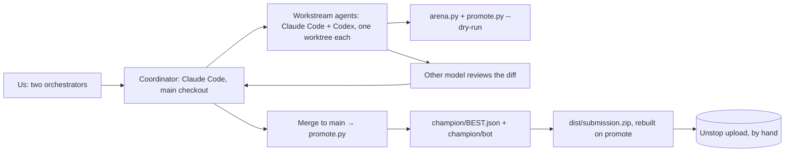
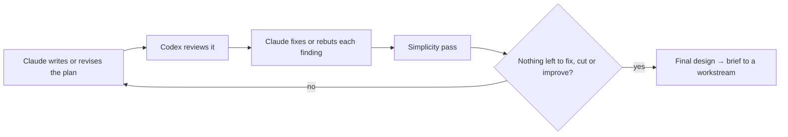

# Development flow

How we build the bot: a fleet of AI agents (Claude Code + Codex) steered by the two of us, a fast scorer,
and a single **champion** record that only ever improves.

## Principles

| Principle | How we apply it |
|---|---|
| **Build the feedback loop first** | `scripts/arena.py` (many seeds × opponents) and `scripts/promote.py` (gauntlet + head-to-head vs champion). **Done.** |
| **One BEST record, raised only by a win** | `champion/` + `champion/BEST.json`, changed **only** by `scripts/promote.py` (lock file + atomic swap) |
| **The submission always equals BEST** | Every promotion rebuilds `dist/submission.zip` from `champion/bot/`. **Upload only that zip to Unstop.** |
| **A fleet of agents, one coordinator** | **Claude Code + Codex** sessions, one per **workstream**, each in its own git worktree; a coordinator Claude session in the main checkout writes briefs, merges, and runs the real promotions. See [agents/README.md](agents/README.md) |
| **One protocol file for every agent** | `AGENTS.md` (Codex reads it natively; `CLAUDE.md` imports it), with the agent protocol below |
| **Cross-model review** | Plan review loop Claude ↔ Codex ([agents/prompts/plan_review.md](agents/prompts/plan_review.md)), plus a diff review by the other model before every merge ([agents/prompts/code_review.md](agents/prompts/code_review.md)) |
| **Solve offline, ship a table, keep a live fallback** | Precompute the 1,755-hand preflop table, evaluator tables and tuned parameters offline; use live Monte Carlo when a table doesn't cover a spot |
| **Find the noise-free signal before tuning** | Duplicate deals + **paired seeds**; head-to-head vs the champion on the same seeds; deterministic sparring bots. (The kit's `random_bot` is unseeded: the same bot scored 15 and 17 gauntlet points on identical seeds.) |
| **Independent attempts, merged, beat one big attempt** | Run independent approaches or parameter sweeps in parallel (different agents, worktrees); keep whichever wins *per component*, merged through promote |

## The setup



## Agent protocol (every agent, every task)

In short: *restate the problem, attack it with parallel subagents, check the answer two ways, measure it on
every test, raise BEST only on a higher score.*

1. **Restate the brief.** Name the workstream, the files it may touch, the strategy items it implements
   (`strategies/NN_*.md` IDs), and the measurable goal.
2. **Solve.** Split independent sub-parts across subagents where useful (e.g. an evaluator and its oracle
   test). Stay inside `bot/` for bot code. No imports beyond stdlib/numpy/scipy, and nothing from `rivals/`.
3. **Check two ways.** Every component needs two independent confirmations, e.g.:
   - **evaluator:** vs the engine's `best_hand` on random hands + hand-written edge cases;
   - **equity:** Monte Carlo vs exact enumeration on small cases;
   - **discard:** the worked examples in `strategies/03_discard.md` + a simulation comparison;
   - **legality:** unit tests + zero `notice`s in engine runs.
4. **Measure.**
   - `pytest`;
   - `scripts/build.py --check`;
   - `scripts/arena.py` for a fast signal;
   - `scripts/promote.py --dry-run` for the real gate.
5. **Raise BEST only by winning.** Agents run `scripts/promote.py --dry-run` from their worktree. When it
   beats the champion, the other model reviews the diff; then the **coordinator** merges to `main` and runs
   `scripts/promote.py --note "<what changed>"`. Real promotions are refused unless the candidate is committed
   on `main`. Never edit `champion/` by hand.
6. **Record.** Update the `Status:` lines in `strategies/`, and commit on the workstream branch.

## Promotion gate (`scripts/promote.py`)

A candidate replaces the champion only if **all** of these hold:
1. **Submission checks pass:** allowed imports, no stray stdout, ≤ 5 MB.
2. **Gauntlet hard gates:** 0 engine notices, 0 forfeits, time used ≤ 60% of the bank.
3. **Head-to-head vs the champion** on paired seeds: z ≥ 2.
4. **Gauntlet match points** ≥ the champion's.

The gauntlet is defined in `champion/gauntlet.json`: opponents, seeds, hands, thresholds. **Add each new sparring
bot there** as it is written (and rivals, if you approve running them). Changing it re-measures the champion
automatically. For the final pick on Sat/Sun, use a **held-out seed range** (GPT-astra) so we don't overfit the
gauntlet seeds.

## Plan review loop (design changes only)



Use it for architecture and for anything risky (time controller, range model, opponent classifier), not for
small tweaks. First up, before Wednesday: [agents/INTERFACES.md](agents/INTERFACES.md). Paste the reviewer's reply back in. Claude answers every finding with *fixed* or *rejected
because …*. We already ran one round: the three research reports, where GPT-astra caught the random-opponent
flaw in our discard study.

## Workstreams

Briefs are in [agents/briefs/](agents/briefs/), module contracts in [agents/INTERFACES.md](agents/INTERFACES.md).

| WS | Area | Strategy items | Orchestrator | Agent |
|---|---|---|---|---|
| W1 | Engine: protocol, legality, fallbacks, time controller | 01 all, 02/E5 | Dev A | Claude Code |
| W2 | Evaluator + equity (scalar → numpy batches), tables | 02/E1–E4 | Dev A | Claude Code |
| W3 | Discard: simulation vs opponent triples, inverse-discard filter | 03/D1–D5 | Dev B | Claude Code |
| W4 | Preflop: offline 1,755-hand table, tiers, sizing | 04 | Dev B | Codex |
| W5 | Postflop betting: pot odds vs ranges, sizes, bluffs | 05 | Dev B | Codex |
| W6 | Opponent stats + archetypes + exploits | 06 | Dev B → A | Codex |
| W7 | Sparring bots (deterministic), gauntlet upkeep, statistics | 08 | Dev A | Codex |

## Sequence (build starts Wed 11 Nov; deadline Sun 15 Nov 23:59 IST)

Each day ends with a **promotion attempt** and, if promoted, an **upload of `dist/submission.zip`**, so the
latest *proven* bot is always the one on Unstop.

| Day | Feedback loop / infra | Workstreams | Exit criterion |
|---|---|---|---|
| **Tue 10** (prep) | ✅ arena, promote, champion **v0** (starter); ✅ briefs W1–W7; **plan review of `agents/INTERFACES.md` (Claude ↔ Codex)** | — | Interfaces approved, worktrees created |
| **Wed 11** | W7: deterministic station / maniac / nit-threshold / min-click bots → gauntlet | W1, W2 (scalar evaluator + MC), W3 D1, W4 tiers, W5 B1–B3 | **v1 promoted and uploaded**: beats v0 head-to-head, 0 notices |
| **Thu 12** | Paired-seed stats; measure σ for sample sizes | W4 offline table (precompute, ship), W2 numpy batches, W5 B4–B6 | v2 promoted (table-driven preflop, sizing) |
| **Fri 13** | Held-out seed set created | W3 D2–D3 (range + inverse discard), W5 B7 | v3 promoted (range-aware) |
| **Sat 14** | Stage 2 timing (`--stage 2 --jobs 1`), slowdown stress test | W6 stats + archetypes; parallel parameter sweeps (independent searches, merge winners) | v4 promoted, **uploaded** |
| **Sun 15** | Freeze by evening. Final held-out evaluation, final upload well before 23:59 | Robustness fixes only | Final zip = champion, re-verified |

## Commands

```bash
.venv/Scripts/python.exe -m pytest                                    # unit + protocol tests
.venv/Scripts/python.exe scripts/build.py --check                     # submission checks for bot/
.venv/Scripts/python.exe scripts/arena.py --rivals random starter --seeds 8   # quick signal
.venv/Scripts/python.exe scripts/promote.py --dry-run                 # full gate, no change
.venv/Scripts/python.exe scripts/promote.py --note "what changed"     # promote if it wins
cat champion/BEST.json                                                # current champion and its scores
```
