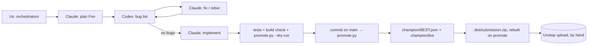

# Development flow

How we build the bot: Claude plans and implements, Codex reviews every plan until it is bug-free, the two of us
orchestrate, and a single **champion** record only ever improves.

## Principles

| Principle | How we apply it |
|---|---|
| **Build the feedback loop first** | `scripts/arena.py` (many seeds × opponents) and `scripts/promote.py` (gauntlet + head-to-head vs champion). **Done.** |
| **One BEST record, raised only by a win** | `champion/` + `champion/BEST.json`, changed **only** by `scripts/promote.py` (lock file + atomic swap) |
| **The submission always equals BEST** | Every promotion rebuilds `dist/submission.zip` from `champion/bot/`. **Upload only that zip to Unstop.** |
| **Plan, review until bug-free, then build** | Claude writes a plan per feature (`agents/plans/`); Codex reviews it and returns a bug list; Claude fixes and resubmits until Codex finds **no bugs**; only then Claude implements. See [agents/README.md](agents/README.md) |
| **One protocol file for every agent** | `AGENTS.md` (Codex reads it natively; `CLAUDE.md` imports it), with the agent protocol below |
| **A second model checks every design** | Codex reviews each plan revision with [agents/prompts/plan_review.md](agents/prompts/plan_review.md); every finding is answered *fixed* or *rejected because …* in the plan's review log |
| **Solve offline, ship a table, keep a live fallback** | Precompute the 1,755-hand preflop table, evaluator tables and tuned parameters offline; use live Monte Carlo when a table doesn't cover a spot |
| **Find the noise-free signal before tuning** | Duplicate deals + **paired seeds**; head-to-head vs the champion on the same seeds; deterministic sparring bots. (The kit's `random_bot` is unseeded: the same bot scored 15 and 17 gauntlet points on identical seeds.) |
| **Independent attempts, merged, beat one big attempt** | Run independent approaches or parameter sweeps in parallel (different agents, worktrees); keep whichever wins *per component*, merged through promote |

## The setup



## Feature protocol (every feature)

Details and the round-by-round mechanics are in [agents/README.md](agents/README.md).

1. **Plan.** Claude writes `agents/plans/Fnn_<name>.md` from the template: goal, scope, design, edge cases,
   failure handling and time, tests (each component **checked two ways**), acceptance criteria, risks.
2. **Review until bug-free.** Codex reviews with `agents/prompts/plan_review.md` and returns a numbered bug list.
   Claude answers each bug in the plan's review log (*fixed* / *rejected because …*) and resubmits. Repeat until
   Codex's verdict is **no bugs**.
3. **Implement** exactly the approved plan. A design change found during implementation goes back to step 2.
4. **Verify:** the plan's tests, `pytest`, `scripts/build.py --check`, `scripts/arena.py`,
   `scripts/promote.py --dry-run`. Examples of two-way checks:
   - **evaluator:** vs the engine's `best_hand` on random hands + hand-written edge cases;
   - **equity:** Monte Carlo vs exact enumeration on small cases;
   - **discard:** the worked examples in `strategies/03_discard.md` + a simulation comparison;
   - **legality:** unit tests + zero `notice`s in engine runs.
5. **Raise BEST only by winning.** Commit on `main` (no AI co-author trailers), then
   `scripts/promote.py --note "Fnn: ..."`. Real promotions are refused off `main` or with uncommitted changes.
   Infrastructure-only features (no behaviour change) are committed without a promotion. Never edit `champion/`
   by hand.
6. **Record.** Mark the feature in `agents/plans/README.md` and the `Status:` lines in `strategies/`.

## Promotion gate (`scripts/promote.py`)

A candidate replaces the champion only if **all** of these hold:
1. **Submission checks pass:** allowed imports, no stray stdout, ≤ 5 MB.
2. **Gauntlet hard gates:** 0 engine notices, 0 forfeits, time used ≤ 60% of the bank.
3. **Head-to-head vs the champion** on paired seeds: z ≥ 2.
4. **Gauntlet match points** ≥ the champion's.

The gauntlet is defined in `champion/gauntlet.json`: opponents, seeds, hands, thresholds. **Add each new sparring
bot there** as it is written (and rivals, if you approve running them). Changing it re-measures the champion
automatically. For the final pick on Sat/Sun, use a **held-out seed range** so we don't overfit the gauntlet seeds.

## Features and workstreams

The feature queue with live status is [agents/plans/README.md](agents/plans/README.md). Module contracts are in
[agents/INTERFACES.md](agents/INTERFACES.md); workstream briefs (inputs to the plans) are in
[agents/briefs/](agents/briefs/).

| WS | Area | Strategy items | Features |
|---|---|---|---|
| W1 | Engine: protocol, legality, fallbacks, time controller | 01 all, 02/E5 | F01 |
| W2 | Evaluator + equity (scalar → numpy batches), tables | 02/E1–E4 | F02, F08 |
| W3 | Discard: simulation vs opponent triples, inverse-discard filter | 03/D1–D5 | F04, F10 |
| W4 | Preflop: tiers, offline 1,755-hand table, sizing | 04 | F05, F07 |
| W5 | Postflop betting: pot odds vs ranges, sizes, bluffs | 05 | F06, F09, F11 |
| W6 | Opponent stats + archetypes + exploits | 06 | F12 |
| W7 | Sparring bots (deterministic), gauntlet upkeep, statistics | 08 | F03 |

## Sequence (build starts Wed 11 Nov; deadline Sun 15 Nov 23:59 IST)

Plans for the next day's features are reviewed the day before, so each build day starts with approved plans.
Each day ends with a **promotion attempt** and, if promoted, an **upload of `dist/submission.zip`**.

| Day | Review loop (plans) | Implement | Exit criterion |
|---|---|---|---|
| **Tue 10** | F01 → approved; F02, F03 in review | — (infra ✅: arena, promote, champion **v0**) | F01–F03 approved |
| **Wed 11** | F04, F05, F06 | F01, F02, F03, then F04–F06 as approved | **v1 promoted and uploaded**: beats v0 head-to-head, 0 notices |
| **Thu 12** | F07, F08, F09 | F07, F08, F09 | v2 promoted (table-driven preflop, sizing) |
| **Fri 13** | F10, F11 | F10, F11 | v3 promoted (range-aware) |
| **Sat 14** | F12 | F12; Stage 2 timing (`--stage 2 --jobs 1`); parameter sweeps | v4 promoted, **uploaded** |
| **Sun 15** | fixes only | Freeze by evening; held-out evaluation; final upload well before 23:59 | Final zip = champion, re-verified |

## Commands

```bash
.venv/Scripts/python.exe -m pytest                                    # unit + protocol tests
.venv/Scripts/python.exe scripts/build.py --check                     # submission checks for bot/
.venv/Scripts/python.exe scripts/arena.py --rivals random starter --seeds 8   # quick signal
.venv/Scripts/python.exe scripts/promote.py --dry-run                 # full gate, no change
.venv/Scripts/python.exe scripts/promote.py --note "what changed"     # promote if it wins
cat champion/BEST.json                                                # current champion and its scores
```
