# Development flow

How we build the bot: Claude Code orchestrates, fixing each strategy file and having Codex review it once; an
Opus 5.5 subagent then implements it; and a single **champion** record only ever improves. This flow started on
**Fri 13 Nov** and replaces the per-feature plan loop (plan → review until bug-free → implement), which was too
slow for the time left. `AGENTS.md` ("Development flow") is the short authoritative version.

## Principles

| Principle | How we apply it |
|---|---|
| **Build the feedback loop first** | `scripts/arena.py` (many seeds × opponents) and `scripts/promote.py` (gauntlet + head-to-head vs champion). **Done.** |
| **One BEST record, raised only by a win** | `champion/` + `champion/BEST.json`, changed **only** by `scripts/promote.py` (lock file + atomic swap) |
| **The submission always equals BEST** | Every promotion rebuilds `dist/submission.zip` from `champion/bot/`. **Upload only that zip to Unstop.** |
| **The strategy file is the spec** | Each area is one file in `strategies/`. It is fixed, reviewed once, fixed again and then implemented from directly. There is no separate plan document. See [agents/README.md](agents/README.md) |
| **One protocol file for every agent** | `AGENTS.md` (Codex reads it natively; `CLAUDE.md` imports it) |
| **A second model checks every spec, once** | Codex (`gpt-6.1-sol`, effort `high`, read-only) returns a bug list for each fixed strategy file; every finding is *fixed* or *rejected because …*. One round, not a loop until clean |
| **Solve offline, ship a table, keep a live fallback** | Precompute tables and tuned parameters offline where time allows; use live Monte Carlo when a table doesn't cover a spot |
| **Find the noise-free signal before tuning** | Duplicate deals + **paired seeds**; head-to-head vs the champion on the same seeds; deterministic sparring bots. (The kit's `random_bot` is unseeded: the same bot scored 15 and 17 gauntlet points on identical seeds.) |
| **One implementer at a time on `bot/`** | Areas are built in dependency order in the main checkout, never in parallel, so later areas build on code that already passed its checks |

## The setup

```mermaid
flowchart LR
    us[Us: direct and approve] --> fix1[Claude Code: fix the strategy file]
    fix1 --> codex[Codex gpt-6.1-sol high: bug list, one round]
    codex --> fix2[Claude Code: fix or reject every bug]
    fix2 --> impl[Opus 5.5 subagent, high effort: implement in bot/]
    impl --> verify[Claude Code: verify the report, tests, build check]
    verify --> next[next strategy area]
    verify --> dry[promote.py --dry-run]
    dry --> promote[commit on main → promote.py]
    promote --> best[champion/BEST.json + champion/bot]
    best --> zip[dist/submission.zip, rebuilt on promote]
    zip --> unstop[(Unstop upload, by hand)]
```



## Strategy-area protocol (every area)

The round mechanics and the exact Codex command are in [agents/README.md](agents/README.md).

1. **Fix.** The orchestrator (Claude Code, main session) reads `strategies/NN_*.md` and fixes its bugs: wrong
   rule facts (checked against `starter_kit/engine.py`), wrong arithmetic, contradictions with other strategy
   files, with `agents/INTERFACES.md` or with the code already in `bot/`. Numeric claims are recomputed or
   simulated.
2. **Review once.** Codex reviews the fixed file and returns a numbered bug list ending in a `VERDICT:` line.
   If Codex is rate-limited, wait for the reset; don't skip the review.
3. **Fix again.** Every reported bug is fixed in the strategy file or rejected with a checkable reason.
   **No code for an area before this step is finished for it.**
4. **Implement.** An Opus 5.5 subagent (effort `high`) implements the area in `bot/` from the corrected file,
   matching `agents/INTERFACES.md`, with each component **checked two ways**:
   - **evaluator:** vs the engine's `best_hand` on random hands + hand-written edge cases;
   - **equity:** Monte Carlo vs exact enumeration on small cases;
   - **discard:** the worked examples in `strategies/03_discard.md` + a simulation comparison;
   - **legality:** unit tests + zero `notice`s in engine runs.
   It leaves its work uncommitted and reports signatures, test results, measured speeds and every deviation.
5. **Verify.** The orchestrator checks the report against the definition of done in `AGENTS.md`: `pytest`,
   `scripts/build.py --check`, a seeded engine match with 0 notices, and timing on `--stage 2 --jobs 1`.
6. **Raise BEST only by winning.** Commit on `main` (no AI co-author trailers) when we ask for it, then
   `scripts/promote.py --note "..."`. Real promotions are refused off `main` or with uncommitted changes.
   Infrastructure-only work (no behaviour change) is committed without a promotion. Never edit `champion/`
   by hand.
7. **Record.** Update the `Status:` lines in `strategies/`.

## Promotion gate (`scripts/promote.py`)

A candidate replaces the champion only if **all** of these hold:
1. **Submission checks pass:** allowed imports, no stray stdout, ≤ 5 MB.
2. **Gauntlet hard gates:** 0 engine notices, 0 forfeits, time used ≤ 60% of the bank.
3. **Head-to-head vs the champion** on paired seeds: z ≥ 2.
4. **Gauntlet match points** ≥ the champion's.

The gauntlet is defined in `champion/gauntlet.json`: opponents, seeds, hands, thresholds. **Add each new sparring
bot there** as it is written (and rivals, if you approve running them). Changing it re-measures the champion
automatically. For the final pick on Sat/Sun, use a **held-out seed range** so we don't overfit the gauntlet seeds.

## Strategy areas and build order

Module contracts are in [agents/INTERFACES.md](agents/INTERFACES.md). The earlier feature plans in
[agents/plans/](agents/plans/) are design references only (F01 is built; F02 covers the evaluator and equity,
F03 the sparring bots); where a plan and its strategy file disagree, the strategy file wins.

| Order | Strategy file | Area | Modules in `bot/` (or elsewhere) |
|---|---|---|---|
| — | 00, 09 | Format facts, rival lessons | reference only, nothing to implement |
| done | 01 | Protocol, legality, fallbacks, time controller | `bot.py`, `brain.py`, `legal.py`, `state.py`, `timing.py`, `log.py` (built as F01) |
| 1 | 02 | Evaluator + equity | `cards.py`, `evaluator.py`, `equity.py` |
| 2 | 03 | Discard: simulation vs opponent triples, reading their discard | `discard.py` |
| 3 | 04 | Preflop: tiers, sizing | `preflop.py` |
| 4 | 05 | Postflop betting: pot odds vs ranges, sizes, bluffs | `betting.py` |
| 5 | 06 | Opponent stats + archetypes + exploits | `opponent.py` |
| 6 | 07 | Mixing, minimum defence frequency | inside `betting.py` / `discard.py` |
| 7 | 08 | Sparring bots, gauntlet upkeep | `scripts/sparring/`, `champion/gauntlet.json` |

## Sequence (deadline Sun 15 Nov 23:59 IST)

Only the skeleton (01) was built by Fri 13 Nov, so the days are compressed. Each day ends with a **promotion
attempt** and, if promoted, an **upload of `dist/submission.zip`**.

| Day | Fix + review | Implement | Exit criterion |
|---|---|---|---|
| **Fri 13** | 00–08 fixed; Codex round on each | 02, then 03, 04, 05 as their reviews are fixed | First real bot: beats v0 head-to-head, 0 notices |
| **Sat 14** | follow-up fixes only | 06, 07, 08; Stage 2 timing (`--stage 2 --jobs 1`) | Promoted and **uploaded** |
| **Sun 15** | fixes only | Parameter sweeps; freeze by evening; held-out evaluation; final upload well before 23:59 | Final zip = champion, re-verified |

## Commands

```bash
.venv/Scripts/python.exe -m pytest                                    # unit + protocol tests
.venv/Scripts/python.exe scripts/build.py --check                     # submission checks for bot/
.venv/Scripts/python.exe scripts/arena.py --rivals random starter --seeds 8   # quick signal
.venv/Scripts/python.exe scripts/promote.py --dry-run                 # full gate, no change
.venv/Scripts/python.exe scripts/promote.py --note "what changed"     # promote if it wins
cat champion/BEST.json                                                # current champion and its scores
```
