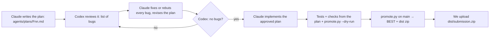

# Agentic loop: Claude plans and implements, Codex reviews

How we build the bot from **Wed 11 Nov**. Every feature goes through one loop:



## Roles

| Role | Who | Does |
|---|---|---|
| **Orchestrators** | the two of us | Choose the next feature, add our intuition to the plan request, carry plans and reviews between Claude and Codex, approve merges and uploads |
| **Planner + implementer** | Claude Code | Writes each feature plan, answers every review finding, implements only after approval, runs the checks and the promotion |
| **Reviewer** | Codex | Reviews each plan revision against the rules, the engine and our interfaces, and returns a numbered **bug list** (or "no bugs") |

Codex reads `AGENTS.md` natively; Claude Code reads `CLAUDE.md`, which imports `AGENTS.md`. Both work on the
same checkout, so Codex can read the plan file and the code it refers to directly.

## Running one round

1. **Claude:** writes or revises `agents/plans/Fnn_<name>.md` (from [plans/TEMPLATE.md](plans/TEMPLATE.md)), marks
   it `Status: in review (round N)`, and pushes.
2. **Whoever has Codex** (the teammate's machine) runs the review with the fixed settings
   (`gpt-6-astra`, effort `medium`, read-only sandbox, prompt `agents/prompts/plan_review.md`):
   ```bash
   git pull
   python scripts/review.py agents/plans/Fnn_<name>.md      # writes agents/plans/reviews/Fnn_<name>.roundN.md
   git add agents/plans/reviews && git commit -m "Fnn review round N" && git push
   ```
3. **Claude** pulls and reads the bug list from `agents/plans/reviews/`. (Pasting the bug list in chat works too.)
4. **Claude:** appends the round to the plan's **Review log**. Each bug gets *fixed (how)* or *rejected (why)*.
   It revises the plan and bumps the round.
5. Repeat 2–4 until Codex replies **"no bugs"**. Claude marks the plan `Status: approved (round N)`.
6. **Claude implements** exactly the approved plan. If implementation reveals a design problem, Claude stops,
   amends the plan, and sends that change back to Codex for review before continuing.
7. **Claude verifies** with the plan's test section (each component checked two ways), `pytest`,
   `scripts/build.py --check`, and `scripts/promote.py --dry-run`. If it beats the champion, Claude commits on
   `main` and runs `scripts/promote.py --note "Fnn: ..."`. Then you upload `dist/submission.zip`.

The status of every feature is tracked in [plans/README.md](plans/README.md).

## Rules
- **No code before approval.** A feature isn't implemented until its plan has a clean review.
- **Every finding is answered.** "Rejected" needs a reason Codex can check (a rule, the engine source, a measurement).
- **One feature per plan,** small enough to review in one sitting. Split anything bigger.
- **Contracts in [INTERFACES.md](INTERFACES.md).** A plan that changes an interface must say so explicitly.
- **No hand edits** to `champion/`, `dist/`, `starter_kit/`, `docs/`, `rivals/_src/`.
- **Rulebook 10.1:** never copy code from public bot repos (including `rivals/_src/`) into `bot/`.
- **The sandbox:** bot code uses only stdlib, numpy and scipy; no file writes, no network, no subprocesses.

## Optional: parallel work
To build two approved features at once, Claude may use a separate git worktree per feature
(`git worktree add ../pokerbots_wt/Fnn -b feat/Fnn main`) and merge to `main` before promoting.
`scripts/promote.py` always uses the single champion in the main checkout and refuses real promotions off `main`.
