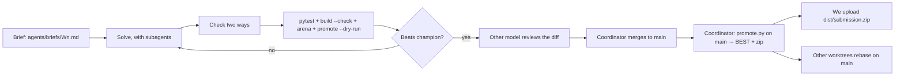

# Agentic loop: Claude Code + Codex

How we build the bot from **Wed 11 Nov**: a fleet of AI agents, orchestrators, one protocol file, a fast
scorer, and a BEST record that only goes up. See [../DEVELOPMENT.md](../DEVELOPMENT.md) for the full flow
and daily sequence.

## Roles

| Role | Who | Where | Does |
|---|---|---|---|
| **Orchestrators** | the two of us | — | Give each agent its brief and our intuition for the approach; decide where effort goes; approve merges and uploads |
| **Coordinator** | one Claude Code session | main checkout, branch `main` | Turns our instructions into briefs; watches the workstream agents; merges branches; runs **real** promotions; rebuilds the zip; tells us what to upload |
| **Workstream agents** | Claude Code and Codex sessions, one per workstream | own git worktree, branch `ws/<id>` | Execute one brief with the agent protocol; promote with `--dry-run` only |
| **Reviewer** | the *other* model | any | Reviews plans (plan review loop) and, before merge, the diff (code review) |

Both tools read the same rules: **Codex reads `AGENTS.md` natively; Claude Code reads `CLAUDE.md`, which imports
`AGENTS.md`.** One protocol file, two models.

### Suggested roster (adjust freely)

| Workstream | Agent | Why |
|---|---|---|
| W1 engine (protocol, legality, time) | Claude Code | Correctness-critical glue |
| W2 evaluator + equity | Claude Code | Our prototype exists (`research/bench_discard.py`) |
| W3 discard | Claude Code | Most strategy-dense; benefits from long context |
| W4 preflop table (offline compute) | Codex | Self-contained script + data file |
| W5 postflop betting | Codex | Clear spec in `strategies/05` |
| W6 opponent model | Codex (Sat) | Clear spec in `strategies/06` |
| W7 sparring bots + gauntlet | Codex | Small independent bots |

Run each agent in its own terminal pane (e.g. Windows Terminal split panes, or a terminal multiplexer under WSL),
so we can watch every agent live and type into any of them. Keep the coordinator pane in the main checkout.

## Worktrees (one per workstream)

```bash
# coordinator, from the main checkout:
git worktree add ../pokerbots_wt/W3 -b ws/W3 main      # create
git worktree list                                      # see all
git worktree remove ../pokerbots_wt/W3                 # after merge
```

Agents use the main checkout's venv by absolute path, e.g.
`D:/CODE/Game_Bots/pokerbots_iiitb/.venv/Scripts/python.exe -m pytest`.
`scripts/promote.py` always uses the **single** champion in the main checkout, even when run from a worktree.

## The loop (per brief)



1. **Brief.** Each workstream starts from `agents/briefs/Wn.md`: goal, files owned, interfaces, strategy IDs,
   checks, done criteria. Paste it, plus any intuition we have, into the agent.
2. **Solve** inside the files the brief owns. Code against [INTERFACES.md](INTERFACES.md); stub what isn't
   merged yet.
3. **Check two ways**, e.g. the evaluator vs the engine's `best_hand` *and* hand-written edge cases.
4. **Measure:** `pytest`, `scripts/build.py --check`, `scripts/arena.py`, `scripts/promote.py --dry-run`
   (from the worktree; the candidate defaults to that worktree's `bot/`).
5. **Review.** The other model reviews the diff with [prompts/code_review.md](prompts/code_review.md). The author
   fixes or rebuts each finding.
6. **Merge and promote (coordinator only).** Rebase the branch onto `main`, merge, run
   `scripts/promote.py --note "<Wn: what>"`. Only `promote.py` touches `champion/` and `dist/submission.zip`.
7. **Upload.** After a promotion, one of us uploads `dist/submission.zip` to Unstop (at least daily).

Infrastructure-only workstreams (W7 sparring bots, gauntlet changes) don't change the bot. They merge
after review without a promotion, and the gauntlet change re-measures the champion automatically.

## Plan review loop (design-level work)

**Claude writes the plan → Codex reviews it → Claude fixes or rebuts every finding →
simplicity pass → repeat** until Codex has no material findings, the simplicity pass cuts nothing, and Claude
finds nothing to improve. Use [prompts/plan_review.md](prompts/plan_review.md). Apply it to:
- the module interfaces ([INTERFACES.md](INTERFACES.md)), **before Wednesday**;
- risky designs: time controller, range model and inverse-discard filter, opponent classifier.

Swap roles (Codex plans, Claude reviews) for workstreams where Codex is the author.

## Rules that keep a multi-agent build safe
- **One owner per file.** Briefs list owned files; shared files (`bot/params.py`) have one section per workstream.
- **Contracts before code.** Change [INTERFACES.md](INTERFACES.md) only through the coordinator, and announce it to all panes.
- **Small merges, often.** Rebase every few hours; never let a branch drift a day from `main`.
- **No hand edits** to `champion/`, `dist/`, `starter_kit/`, `docs/`, `rivals/_src/`.
- **Rulebook 10.1:** never copy code from public bot repos (including `rivals/_src/`) into `bot/`.
- **The sandbox:** bot code uses only stdlib, numpy and scipy; no file writes, no network, no subprocesses.
