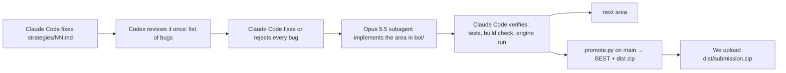

# Agentic loop: Claude Code orchestrates, Codex reviews, Opus implements

How we build the bot from **Fri 13 Nov**. It replaces the per-feature plan loop (Claude writes a plan, Codex
reviews until "no bugs", Claude implements), which was too slow for the time left. Every strategy area goes
through one pass:



## Roles

| Role | Who | Does |
|---|---|---|
| **Directors** | the two of us | Set the order and the priorities, approve commits, promotions and uploads |
| **Orchestrator** | Claude Code (main session) | Fixes each strategy file, runs Codex on it, answers every finding, briefs the implementer, verifies its report |
| **Reviewer** | Codex CLI, `gpt-6.1-sol`, effort `high`, read-only | Reviews one fixed strategy file and returns a numbered **bug list** ending in a `VERDICT:` line |
| **Implementer** | Opus 5.5 subagent, effort `high` | Implements one strategy area in `bot/` from the corrected file, with tests; reports back |

Codex reads `AGENTS.md` natively; Claude Code reads `CLAUDE.md`, which imports `AGENTS.md`. All of them work on
the same checkout.

## Running one area

1. **Fix.** The orchestrator reads `strategies/NN_*.md` and corrects it: rule facts against
   `starter_kit/engine.py`, arithmetic and probabilities (recomputed or simulated), contradictions with other
   strategy files, with [INTERFACES.md](INTERFACES.md) or with the code already in `bot/`.
2. **Review once.** One Codex call per strategy file:
   ```bash
   codex exec -m gpt-6.1-sol -c 'model_reasoning_effort="high"' -s read-only -C . --color never \
       -o <review file> "<prompt: review strategies/NN_*.md for spec bugs against starter_kit/engine.py, AGENTS.md, agents/INTERFACES.md and bot/; reply as a numbered bug list with severity, proof and FIX, ending in VERDICT>"
   ```
   `gpt-6-astra` is no longer used (it burns the usage limit, which is shared by every model on the account).
   If Codex is rate-limited, wait for the reset. Don't skip the review.
3. **Fix again.** Every bug is fixed in the strategy file, or rejected with a reason that can be checked (a rule,
   an engine line, a measurement). One round only; the file is not sent back until clean.
4. **Implement.** The orchestrator starts one Opus 5.5 subagent (effort `high`) with a brief naming the strategy
   file, the items in scope, the files it may touch and the checks it must run. Areas are built **one at a time,
   in dependency order: 02 → 03 → 04 → 05 → 06 → 07 → 08**, in the main checkout. The subagent does not commit
   and does not spawn further agents. It reports: files changed, public signatures, test results, measured
   speeds, every deviation from the spec, and anything unfinished.
5. **Verify.** The orchestrator checks the report against the definition of done in `AGENTS.md` (`pytest`,
   `scripts/build.py --check`, a seeded engine match with 0 notices, timing on `--stage 2 --jobs 1`) before the
   next area starts, and updates the `Status:` lines in `strategies/`.
6. **Promote.** When we ask for it: commit on `main`, `scripts/promote.py --dry-run`, then
   `scripts/promote.py --note "..."`. Then we upload `dist/submission.zip`.

## Rules
- **No code for an area before its review round is fixed** (step 3).
- **Every finding is answered.** "Rejected" needs a reason that can be checked.
- **The strategy file is the spec.** Files 00 and 09 are reference only. The plans in [plans/](plans/) and their
  reviews are design references from the earlier loop (F01 is built; F02 = evaluator and equity; F03 = sparring
  bots); where a plan and its strategy file disagree, the strategy file wins. `scripts/review.py` and
  [prompts/plan_review.md](prompts/plan_review.md) belong to that earlier loop.
- **Contracts in [INTERFACES.md](INTERFACES.md).** An implementation that needs a different signature says so in
  its report; the orchestrator updates the contract.
- **One implementer at a time on `bot/`.** No parallel subagents, no worktrees.
- **No hand edits** to `champion/`, `dist/`, `starter_kit/`, `docs/`, `rivals/_src/`.
- **Rulebook 10.1:** never copy code from public bot repos (including `rivals/_src/`) into `bot/`.
- **The sandbox:** bot code uses only stdlib, numpy and scipy; no file writes, no network, no subprocesses.
- **Commits** only when we ask, with no AI co-author or attribution trailers.
